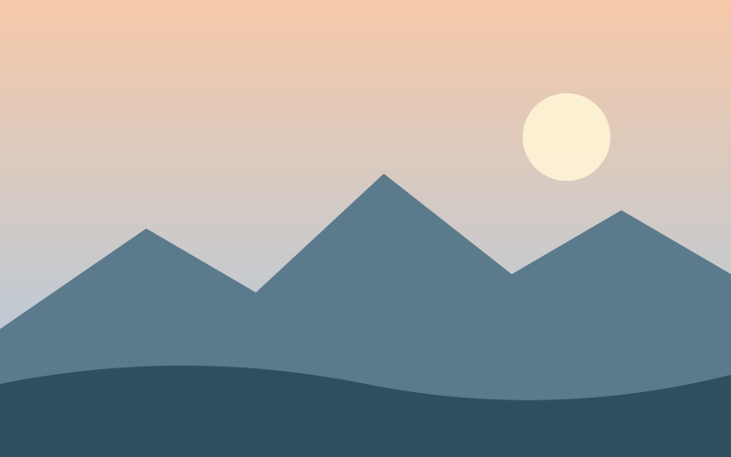
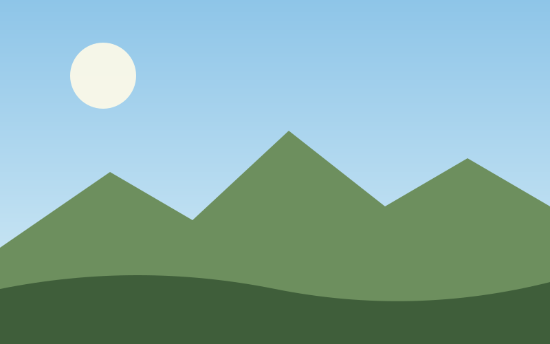
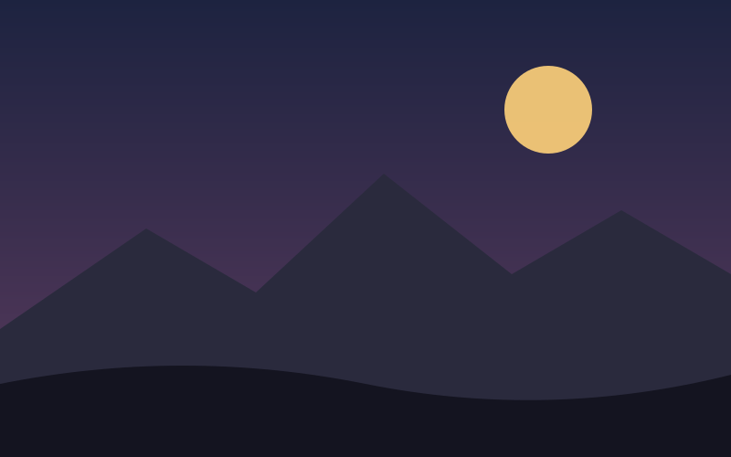

# Kolme päivää erämaassa

Lähdettiin aamulla kuuden jälkeen. Reppu painoi enemmän kuin piti, mutta sää oli *täydellinen*.

## Ensimmäinen päivä

Polku kulki ensin kuusikossa ja nousi sitten tunturin rinteelle. Pidettiin tauko puron varressa ja keitettiin kahvit.

## Kodalla

Illalla kodalla tuli paloi pitkään. Joku kertoi tarinan, jota kukaan ei uskonut, ja kaikki nauroivat silti.

Kotiin palattiin kolmantena päivänä väsyneinä ja tyytyväisinä. Ensi kerralla kevyempi teltta.
